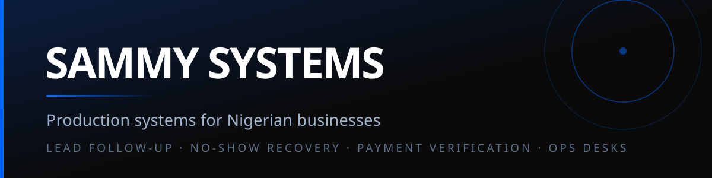

## We build operating systems for service businesses, so they grow and scale without manual work.

Ops desks, concierges, no-show recovery, payment gates.

     

---

## The problem

Businesses rarely lose work in the office. They lose it in the gaps — the lead answered nine hours late, the slot nobody recovered, the "I paid" nobody checked.

## What we build

|  | System | The failure it prevents |
|---|---|---|
| **Ops desk** | Leads, jobs, follow-ups and dispatch on one screen with SLA clocks | Work sits unanswered until the customer gives up |
| **Booking concierge** | An embeddable desk that answers from committed facts and captures real bookings | A chatbot invents a price and you never hear about it |
| **No-show recovery** | Automated reactivation sequences and slot recovery | An empty chair costs more than the email that would have filled it |
| **Payment verification** | Receipt read, verified against the order, owner notified | "I paid" with nothing to check it against |

## Selected work

### [realestate-portal](https://github.com/Sammysystems/realestate-portal) — Ops desk
A lead waits nine hours for a first reply; a land search stalls eighteen days before anyone notices. Every lead carries a **4-hour SLA clock**, every stalled deal is flagged by stage day-limit, and the auto first-reply is assembled from the database row — so a hallucinated price is structurally impossible here, not unlikely. 7 board views, and an email dispatch history that logs the failures too.

`React 19 · Vite · Tailwind 4 · Postgres · Vercel` · [Live demo →](https://realestate-portal-ten.vercel.app)

### [dmi-concierge](https://github.com/Sammysystems/dmi-concierge) — Booking concierge
An embeddable desk for a photography studio that drops in as a single `<script>` tag. **Money never comes from the model** — any reply stating a naira figure that isn't on the committed rate card is caught in code and corrected. A booking only completes with a valid email; then it mints a reference, emails both sides and hands off to WhatsApp. No database, 33 e2e checks, iframe-isolated.

`React 19 · Vite · Gemini embeddings · OpenRouter/NVIDIA fallback · Resend`

### [clearsmile-patient-reactivation](https://github.com/Sammysystems/clearsmile-patient-reactivation) — No-show recovery
Scans six months of overdue patients and runs a **day 0 / 7 / 14** reactivation sequence, with self-serve booking, day-before reminders, no-show recovery and a staff handoff queue. Outbound email is opt-in behind an `EMAIL_LIVE` guard, capped at `MAX_EMAILS_PER_RUN`, so a misconfigured deploy cannot blast a patient list. Built in public over 30 days.

`React 19 · TypeScript · Postgres · Resend · Vercel`

### [proofgate](https://github.com/Sammysystems/proofgate) — Payment verification without a payment gateway
A Telegram bot reads the customer's bank-transfer receipt with Gemini Vision — photo, PDF or screenshot — extracts amount and reference, verifies them against the order, and returns **CONFIRMED** or **HOLD**, then emails the owner. Three-tier OCR fallback. **21/21 tests**; code review, security review and ship-check all committed. Runs on free tiers.

`Google Apps Script · Telegram · Gemini Vision`

## How we work

Every system goes through a production gate before it ships: non-functional requirements, a capacity budget, an FMEA, a degradation matrix, load tests to the knee, and a launch decision that is allowed to say no. One of our builds was **blocked at its own gate with six named blockers** rather than handed a green light. Readiness docs, runbooks and raw load-test output live in the repos.

## Available for

Full-time engineering roles · contract builds · system audits — Case studies and private work available on request.
